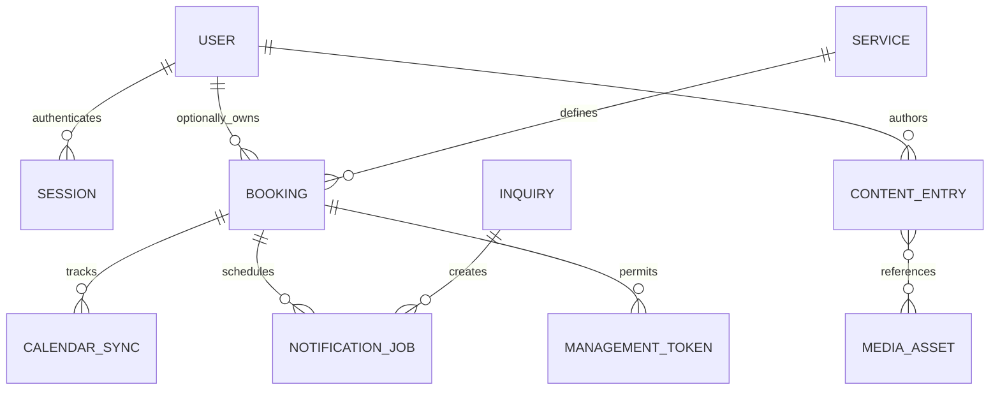

# Technical plan and decision record

Status: planning specification. No schema migrations or integrations are implemented here.

## Established decisions

| Decision | Rationale | Consequence |
| --- | --- | --- |
| One Next.js application | Shared public UI, admin and server-side operations | Keep domain logic separate from route handlers; no separate API service initially |
| PostgreSQL for transactional data | Constraints and transactions support reservations and jobs | Choose migration/data access tooling before Sprint 2 schema work |
| Build product workflows ourselves | Demonstrate engineering through usable tools | Reuse auth, editing and chess primitives; own the workflows and integration code |
| Google Calendar adapter | Owner continues using existing business calendar | Local state and external events need reconciliation and idempotency |
| Separate game engine and conversational AI | Legal play is deterministic; explanations are probabilistic | Model responses never directly mutate authoritative game state |
| Durable notification outbox | Email should not disappear when a request/process fails | Requires a scheduled worker/runner, not in-memory timers |
| Render Free + Neon Free for development | Owner-approved hosting choice | Run Next.js UI and backend in one Node service; connect to managed PostgreSQL server-side; provisioning and CD remain pending |
| Root-level theme tokens | All pages inherit consistent appearance | Existing persistent light/cyberpunk toggle remains shared |

## Conceptual data model

Names are provisional; the migration design will refine fields and constraints.

| Entity | Key concepts |
| --- | --- |
| User / Session | Auth-library schema, owner role; future client/student access; no homemade password cryptography |
| Service | Consultation duration, buffer, active status; future mentoring price reference |
| AvailabilityRule / Exception | Owner IANA time zone, local weekday intervals, date exceptions; keep DST semantics |
| Booking | Opaque ID, service, nullable user ID, guest contact, start/end UTC, display timezone, status and idempotency key |
| CalendarConnection | Owner, calendar identifier, encrypted tokens, token expiry and connection health |
| CalendarSync | Booking, external event ID, operation version, status, attempt count, retry time |
| NotificationJob | Event/version deduplication key, template, recipient reference, scheduled time, attempts, status |
| ManagementToken | Token hash, booking, scope, expiry/revocation; raw secret only in delivered link |
| ContentEntry | Kind, slug, title, summary/body, draft/published state, publish timestamp, author, revision |
| MediaAsset | Storage key, type/size, alt text, publication visibility |
| Inquiry | Contact and project description, received time, delivery status |

Guest bookings must not create accounts implicitly. Never grant booking ownership
solely because a user types a matching email; attach records only through verified
identity/claim workflows. User role and resource ownership are separate checks.
No stored chess games are needed for launch; retain only necessary operational
usage records, not entire conversations by default.

## Booking consistency

State proposal: reserved -> pending_calendar -> confirmed -> cancelled, with
expired and failed terminal states. Store retryable operation status separately.
Enforce active interval non-overlap in PostgreSQL (including buffers), not just a
frontend availability check. Recheck Google busy times before confirmation.
Google writes cannot participate in a database transaction: persist an operation,
use a stable external identifier where supported, and recover/reconcile safely.
Manual Google edits may race with website booking; detect and surface conflicts,
never promise that a free/busy check alone eliminates every external race.

A reschedule keeps the existing appointment until the replacement can be safely
reserved and synchronized. Version notifications so obsolete reminders are ignored.
Email failure does not roll back a confirmed calendar booking. Failed calendar
creation must not send a normal confirmation. Avoid double-sending Google attendee
notifications and app messages without a deliberate notification policy.

## API/module boundaries

- Public page queries return only published content.
- Booking service owns policy validation, slot reservations and transitions.
- Calendar adapter owns OAuth and Google API translation, not UI state.
- Notification service owns templates and durable delivery jobs.
- Chess rules module owns move validation; engine adapter chooses opponent moves.
- AI adapter receives bounded validated game context, enforces budget, and labels responses.
- Server authorization checks apply before queries and mutations; no reliance on route groups.

## Technical choices to resolve before implementation

| Choice | Timing | Selection criteria |
| --- | --- | --- |
| Authentication library | Sprint 2 | Maintained Next.js support, server sessions, verified identity, owner provisioning/recovery |
| SQL/data access tooling | Sprint 2 | Versioned migrations, transactions, PostgreSQL constraints, inspectable queries |
| Render/Neon setup + durable worker | Sprint 2 | Configure selected providers and environments; resolve scheduled execution separately from the sleeping free web service |
| Neon configuration / object storage choice | Sprint 2–4 | Database access and recovery; separate storage for private drafts and public assets |
| Editor primitive | Sprint 4 | Structured content, safe rendering, code blocks, accessible editing |
| Email provider | Sprint 3 basic / 8 full | Domain authentication, delivery events, sandbox support, costs |
| Rules library / engine | Sprint 6 | Rules completeness, worker execution, license obligations and distribution approach |
| AI API / model | Sprint 7 | Position-grounded explanation quality, latency, budget and data handling |

Do not select paid plans or provision accounts as part of planning. Inspect current
official documentation and run focused compatibility spikes when making these choices.
The stack and development hosting providers are established; remaining vendor choices
are explicit open decisions. No hosting accounts or services have been provisioned.
