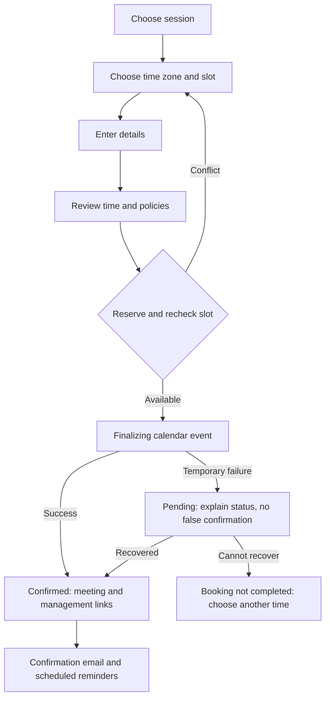

# UI/UX specification — review draft

These are structural wireframes, not final copy or implemented screens. Examples
such as appointment times, projects, and article titles are intentionally omitted
until real data/content is available.

## Visual and interaction rules

Use the existing light theme and finance-app cyberpunk dark theme. Dark palette:
background #070a12, foreground #e8fbff, muted text #8faab2, primary #38f5c2,
cyan #29e8ff, magenta #ff58d0, green #55ff9a. Keep grids/glows subtle.
Use cyan for emphasis and magenta selectively around the AI demo; never rely on
color alone for availability, validation or game status. Reserve body text for
high-contrast neutral tones. Use a spacing scale and shared buttons/form controls.

Target WCAG 2.2 AA: keyboard operation, visible focus, semantic headings, properly
labeled controls, errors connected to fields, readable contrast, reduced motion,
and generous touch targets. Verify at 320, 375, 768 and 1280 CSS pixels without
horizontal page overflow. Multi-column layouts stack; controls retain labels.

## Homepage

Desktop:
```text
[GriffamDev]  Work  Services  Learn  About   [Theme] [Book a call]
----------------------------------------------------------------
Enoch Griffith / Full Stack Software Engineer
[Clear value proposition]                 [Optional real imagery]
[Discuss a project] [View work]
----------------------------------------------------------------
Selected work       [Case study] [Case study]
AI chess            [Demo description] [Play] [How it was built]
Services            [Service] [Service] [Service]
Working together    Discovery -> Scope -> Build -> Launch
About Enoch         [Short bio] [About] [Resume]
Learn               [Latest article] [Latest video]
[Final contact invitation]                        [Book a call]
[Footer: Contact | Resume | LinkedIn | Policies]
```
Mobile:
```text
[GriffamDev] [Theme] [Menu]
[Name + exact title]
[Value proposition]
[Discuss a project]
[View work]
[Case study]
[Case study]
[AI chess invitation + Play]
[Services, stacked]
[Process, stacked]
[Bio + Resume]
[Learning content, stacked]
[Contact + footer]
```
Mobile menu opens a labeled navigation panel; Escape closes it and returns focus
to the trigger. Do not hide booking or theme selection behind hover behavior.

## Service and project pages

```text
SERVICE                       CASE STUDY
[Problem and intended client]  [Project title + truthful context]
[What you receive]            [Problem / constraints]
[Relevant project proof]      [Your role and contribution]
[Process and boundaries]      [Screenshots with alt text]
[Book consultation]           [Approach and tradeoffs]
                              [Verified result / lessons]
                              [Live/source links if public]
                              [Discuss a similar project]
```
Stack all sections on mobile. No fake outcome metrics. Missing work uses an honest
empty state until approved projects exist. The chess project can be a first-party
case study, explicitly labeled as a GriffamDev demo.

## Blog, video, about and resume

Blog index: title, topic/date, summaries -> article. Article: readable narrow
column, title/date, content/code, related posts. Videos: title/summary -> video
page with player, captions/transcript where available, resources and related work.
About: name, title, bio, work approach, resume and LinkedIn. Resume: visible PDF
preview plus accessible download link; if absent, show no broken download button.
Empty Learn sections state that content is upcoming and offer other working links.

## Booking screens

Desktop:
```text
[1 Session] -> [2 Time] -> [3 Details] -> [4 Review]
[Session length + policies] | [Month calendar] | [Available times]
                           | [Time-zone picker]
[Selected date/time summary, always labeled with time zone]
[Name] [Email] [Project goal] [Policy acknowledgement]
[Review details] -> [Confirm booking]
```
Mobile: session summary -> time zone -> calendar -> time buttons -> details ->
review. Preserve form input when going backward or when a slot becomes unavailable.
Do not require an account for a free consultation. Protect reschedule/cancel via
expiring opaque management tokens; never place email or private details in URLs.



| State | What the visitor sees | Available action |
| --- | --- | --- |
| Loading availability | Calendar loading status, no stale selectable slots | Wait or retry on failure |
| No times available | Clear empty state | Change date range or contact Enoch |
| Calendar disconnected | Booking temporarily unavailable | Contact Enoch; admin sees reconnect action |
| Invalid details | Inline field errors; focus first invalid field | Correct details without losing slot context |
| Slot conflict | Selected slot no longer available | Choose alternatives; preserve entered details |
| Pending synchronization | Processing status and booking reference | Check status; do not submit duplicates |
| Confirmed, email delayed | Confirmed on-page details | Copy details; delivery retry happens separately |
| Expired management link | No private booking details exposed | Request a new link via email |
| Cancel/reschedule | Original and proposed details, policy, confirmation step | Confirm or go back |

## AI chess

Desktop:
```text
[Chess with AI] [How it works]
[Side] [Difficulty] [Coach mode] [Start game]
[Board + coordinates]           [Chat: clearly labeled AI]
[Turn / check / result]         [Suggested prompt: Explain that move]
[Move history]                  [Messages]
[Resign] [New game]             [Message input] [Send]
```
Mobile: controls -> board -> turn/result -> compact move history -> chat. Board
fits viewport, chat never covers squares. Tap source then destination; dragging
is optional. Keyboard can select squares and make moves, with square names and
turn/check/result announcements. Promotion opens an explicit piece chooser.

Illegal move: explain and keep position unchanged. Engine thinking: disable new
player moves until ready. Game over: name result, offer restart. Engine failure:
keep board and offer retry. Chat unavailable/quota reached: explain in chat while
engine play continues. A delayed AI explanation must not be presented as describing
a newer position; show the move/position it refers to. Hints are optional in coach
mode. Resign/restart require confirmation during an active game.

## Admin publishing and bookings

Desktop: sidebar (Overview, Content, Bookings, Availability, Media, Notifications)
plus content panel. Mobile: labeled menu and single-column editor. Admin sign-in
is separate from public learning and must not expose an unprotected dashboard.

```text
[Content list: title, draft/published, updated time] [New article]
  -> [Title] [Slug] [Summary] [Body editor] [Media/alt text]
  -> [Save draft] [Preview] [Publish]
```
Draft saving has saving/saved/failed states. Unsaved navigation prompts the editor.
Preview is authenticated or uses a scoped expiring token; draft URLs are not public.
Publishing validates required fields and reports success/failure. Conflicting edits
are surfaced rather than silently overwriting newer content. Media uploads show
progress, type/size errors and retry. Resume replacement becomes public only after
successful upload and validation.

Bookings admin: upcoming list, appointment details, cancellation/rescheduling,
sync status, failed notifications and retry. Availability editor shows time zone,
weekly rules, exceptions and a preview before saving. Calendar connection status
shows connected/reconnect needed; never displays credentials.

## Post-launch account dashboard wireframe

[Next appointment / Join / Manage] -> [History] -> [Resources] -> [Profile].
Only render sections that have functionality. Empty appointments offer booking;
expired session returns to sign-in preserving a safe return path. Enforce ownership
on every server operation; hiding controls is not authorization.
